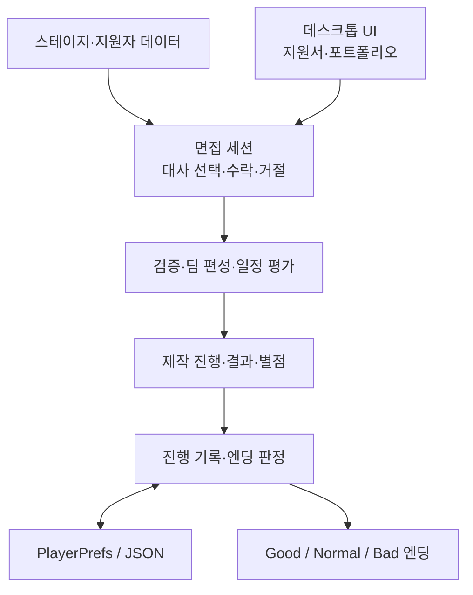

# ohabjizol-teams-game


학교 팀 프로젝트로 개발한 Unity 면접·팀 구성 게임임. 지원자의 대사·문서·능력·일정을 검토해 게임잼 팀을 선발하고, 제작 결과와 엔딩을 확인함.

> 빌드 배지: 실제 플레이·빌드 실행 결과 미검증 상태를 표시함.

## Demo / Preview

<!-- 실제 플레이 영상·GIF·스크린샷을 이 영역에 직접 추가함. -->

플레이 영상·GIF 추가 영역임.

## Install & Usage

### 준비 사항

- Unity Hub 및 **Unity 6000.3.15f1** 필요함. 기준: [ProjectVersion.txt](ProjectSettings/ProjectVersion.txt).
- Git 및 Unity 패키지 복원을 위한 인터넷 연결 필요함.

### 실행

1. 저장소 복제함.

   ```bash
   git clone https://github.com/goldsw/ohabjizol-teams-game.git
   cd ohabjizol-teams-game
   ```

2. Unity Hub에서 `Assets/`, `Packages/`, `ProjectSettings/`가 있는 저장소 루트를 프로젝트로 추가함.
3. Unity **6000.3.15f1**로 열고 패키지 복원·에셋 임포트 완료까지 대기함.
4. `Assets/Scenes/MainMenuScene.unity`를 열고 **Play** 실행함.

첫 빌드 씬도 `MainMenuScene`으로 등록되어 있음. 씬 구성은 [EditorBuildSettings.asset](ProjectSettings/EditorBuildSettings.asset)에서 확인 가능함.

## Features & Architecture

### 기술 스택

- **엔진·언어:** Unity **6000.3.15f1**, C#.
- **렌더링:** Universal Render Pipeline **17.3.0**. 기본 렌더 설정은 `Assets/Settings/PC_RPAsset.asset` 사용함.
- **UI·입력:** Unity UI(uGUI) **2.0.0**, Input System **1.19.0**. 데스크톱형 창 UI와 키보드·마우스 입력에 사용함.
- **데이터:** 지원자·문서·일정의 C# 모델, ScriptableObject 카탈로그·프로필, JSON 원본 데이터로 구성함.
- **진행 저장:** `PlayerPrefs`에 `JsonUtility`로 직렬화한 JSON 저장함.
- **테스트 도구:** Unity Test Framework **1.6.0** 등록됨. `Assets/Tests/Editor/`에 규칙 검증 코드 있음. 실행 결과는 미검증임.

<details>
<summary>기타 등록 패키지 — 게임 기능 사용 여부 별도 확인 필요</summary>

- 2D Aseprite **3.0.2**, AI Navigation **2.0.12**, Timeline **1.8.12**.
- Visual Scripting **1.9.11**, Multiplayer Center **1.0.1**, Unity Pipeline **0.8.0-exp.1**.
- Unity Version Control 연동(`com.unity.collab-proxy`) **2.12.4**, Rider 연동 **3.0.39**, Visual Studio 연동 **2.0.26**.

</details>

버전 기준: [manifest.json](Packages/manifest.json), [packages-lock.json](Packages/packages-lock.json).

### 주요 시스템

- **면접·대사 검증:** 지원자 대사를 선택하고 수락·거절할 때 검증 결과를 누적함. [InterviewSession](Assets/Scripts/Interview/Rules/InterviewSession.cs), [VerificationRule](Assets/Scripts/Interview/Rules/VerificationRule.cs).
- **문서 기반 판단:** 지원서·포트폴리오 등 문서를 데스크톱형 창으로 열람함. [문서 창 UI](Assets/Scripts/Interview/UI/Windows/), [데스크톱 UI](Assets/Scripts/Presentation/Desktop/).
- **팀 편성:** 선발 인원과 표시 능력·실제 능력 합계를 관리함. 현재 기본 단계 정원은 **6명**임. [TeamRoster](Assets/Scripts/Interview/Rules/TeamRoster.cs), [StageExecutionPolicy](Assets/Scripts/Interview/Stages/StageExecutionPolicy.cs).
- **일정·점수 평가:** 선발 팀원의 불가 일정과 프로젝트 일정을 대조하고 일정 페널티를 계산함. [InterviewScheduleProcessor](Assets/Scripts/Interview/Rules/InterviewScheduleProcessor.cs), [SchedulePenaltyRule](Assets/Scripts/Interview/Rules/SchedulePenaltyRule.cs).
- **제작 결과·엔딩:** 제작 진행 화면, 결과 별점, Good / Normal / Bad 결과·엔딩 분기 구현됨. [Result](Assets/Scripts/Interview/Result/), [CampaignRunProgress](Assets/Scripts/Interview/Stages/CampaignRunProgress.cs).
- **진행 기록·이어하기:** 단계 완료 여부와 점수를 저장·불러오고 메인 메뉴에서 진행을 재개함. [CampaignRunStore](Assets/Scripts/Interview/Unity/CampaignRunStore.cs), [MainMenuController](Assets/Scripts/Presentation/MainMenuController.cs).
- **튜토리얼:** 문서함·지원서·포트폴리오 조작 안내와 메인 메뉴 복귀 흐름 있음. [Tutorial](Assets/Scripts/Tutorial/).

> **현재 실행 범위:** `StageExecutionPolicy.SingleStageMode = true` → `EntranceGameJam` 한 단계 활성화됨. 4단계 캠페인 데이터 구조가 별도로 존재하며, 활성 단계의 기본 정원은 6명임.

### 주요 폴더 구조

```text
Assets/
├── Scripts/
│   ├── Interview/          # 핵심 게임 시스템
│   │   ├── Data/           # 지원자·문서·일정 데이터 모델
│   │   ├── Rules/          # 면접 진행·검증·팀 편성·점수 규칙
│   │   ├── Stages/         # 단계 정의·활성 정책·캠페인 진행
│   │   ├── Unity/          # ScriptableObject·Unity 저장 연동
│   │   ├── UI/             # 면접 화면·문서 창
│   │   └── Result/         # 제작 진행·결과·엔딩 분기
│   ├── Tutorial/           # 조작 안내·튜토리얼 흐름
│   ├── Presentation/       # 씬 전환·카메라·데스크톱 연출
│   ├── Managers/           # 공통 관리 컴포넌트
│   └── UI/                 # 공통 UI 구성
├── Scenes/                 # 메뉴·면접·제작 진행·결과·엔딩 씬
├── Data/Interview/         # 카탈로그·프로필 .asset 및 원본 JSON
├── Prefabs/                # 재사용 프리팹
├── Art/                    # 아트 리소스
├── Audio/                  # 오디오 리소스
├── Settings/               # 렌더 파이프라인 등 설정
├── Editor/                 # 에디터 제작 도구
└── Tests/Editor/            # 게임 규칙 검증 코드
Packages/                   # 패키지 선언·잠금 버전
ProjectSettings/            # 엔진 버전·씬·입력·프로젝트 설정
AI/                         # 한국어 작업 문서
Tools/                      # 개발 보조 도구
graphify-out/               # 코드 관계 분석 산출물
```

### 시스템 흐름



면접 규칙·진행 상태를 `Interview/Rules`·`Stages`에 두고, Unity 데이터·저장 연동은 `Interview/Unity`, 화면·연출은 `UI`·`Presentation`·`Result`에서 담당함. 위 다이어그램은 주요 시스템의 데이터·진행 흐름을 나타냄.

## Contributing & License

- **기여:** 이슈에 재현 절차·사용 Unity 버전·관련 씬을 기재하고, PR에 변경 목적·확인 결과를 포함함.
- **Unity 에셋:** 씬·프리팹·리소스 변경 시 대응하는 `.meta` 파일을 함께 포함함.
- **프로젝트 라이선스:** 저장소 루트에 `LICENSE` 파일 없음. 공개 라이선스 미지정 상태임.
- **외부 패키지·에셋:** 각 배포자의 라이선스 문서 확인 필요함.
